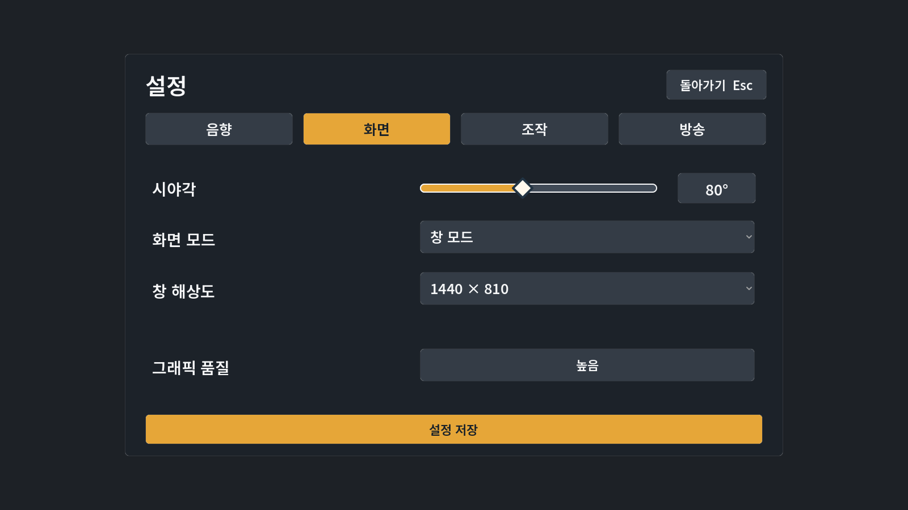

# 바위너구리 정리하기 / Rock & Rest

120종 × 10마리, 1,200마리의 바위너구리를 제자리에 정리하는 1인칭 게임입니다.

## Windows 다운로드

**[최신 배포판 다운로드](https://github.com/INTPEDITOR/rock-and-rest-downloads/releases/latest)** · **[v0.8.2 ZIP 바로 받기](https://github.com/INTPEDITOR/rock-and-rest-downloads/releases/download/v0.8.2/RockAndRest_v0.8.2_Windows.zip)**

로그인 없이 받을 수 있습니다. ZIP 전체를 압축 해제하고 **RockAndRest.exe**를 실행하세요. 기존 저장은 이어하기로 불러올 수 있습니다.

## v0.8.2 도전미션 연동

- 도전미션에 별풍선이 모금되면 성공 여부를 기다리지 않고 일반 후원과 같은 효과를 순서대로 실행합니다.
- 한 건의 수량이 **50·51·112·444·4444개**일 때 적용합니다. 미션 총 모금액으로 판정하지 않습니다.
- 실패·취소해도 실행한 효과를 되돌리지 않으며 성공 상금 지급 때 다시 실행하지 않습니다.
- 공식 SOOP 이벤트 구조와 합성 후원 기반 게임 동작 검사를 통과했습니다. 실제 도전미션 후원 수신은 실방송 검증 전입니다.

## v0.8.1 화면 설정 수정

- 시야각·음량·감도·품질을 바꿀 때 창 크기·위치가 다시 적용되던 문제를 수정했습니다.
- 설정 → 화면 → **창 해상도**에서 크기를 선택할 수 있습니다. 선택값을 저장하며 현재 모니터에 들어가는 크기만 표시합니다.
- 전체 화면은 모니터 해상도를 사용합니다. 창 모드로 복귀하면 이전 크기·위치 또는 최대화 상태를 복원합니다.

## 조작

WASD 이동 · 마우스 시점 · Shift 달리기 · E 또는 왼쪽 클릭 길게 줍기/정리/채굴 · Q 내려놓기 · Tab 성장 · Esc 메뉴.

## 악세사리

v0.8.0에서 모자·가방의 곡면, 봉제선·버클, 직업별 장식과 귀·왕관·날개를 개선했습니다. 원본 캐릭터와 120종, 기존 저장 진행을 유지합니다.

## SOOP 연동

환경 설정에서 방송국 **아이디 또는 주소**를 입력합니다. 표시 닉네임 검색은 지원하지 않습니다. 채팅방 입장은 확인했으며 실제 별풍선 수신은 실방송 검증 전입니다.

## 확인한 범위

v0.8.2 소스·배포 EXE 기본 검사 각각 2,386개, 배포 EXE 실제 OpenGL 창 검사 2,389개 통과 / 실패 0개. 실제 창에서 시야각·음량·감도·품질 변경 후 크기와 위치 유지, 해상도 선택으로 1280×720 및 1600×900 전환을 확인했습니다. 전체 화면·최대화 복원은 창 상태 모형으로 검사했습니다.

이 저장소에서는 Windows 실행 파일을 배포합니다. 구성 요소 라이선스는 ZIP 안의 CREDITS.txt와 licenses 폴더에 있습니다.
