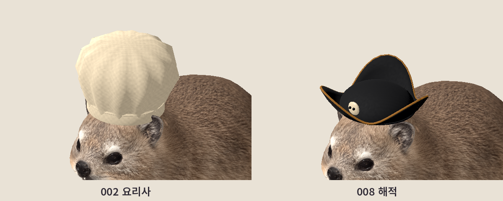

# 바위너구리 정리하기 / Rock & Rest

120종 × 10마리, 1,200마리의 바위너구리를 제자리에 정리하는 1인칭 게임입니다.

## Windows 다운로드

**[최신 배포판 다운로드](https://github.com/INTPEDITOR/rock-and-rest-downloads/releases/latest)**

[v0.8.0 ZIP 바로 받기](https://github.com/INTPEDITOR/rock-and-rest-downloads/releases/download/v0.8.0/RockAndRest_v0.8.0_Windows.zip)

GitHub 로그인 없이 다운로드할 수 있습니다. ZIP 전체를 압축 해제한 뒤 **RockAndRest.exe**를 실행하세요. 기존 저장은 이어하기로 불러올 수 있습니다.

## 조작

WASD 이동 · 마우스 시점 · Shift 달리기 · E 또는 왼쪽 클릭 길게 줍기/정리/채굴 · Q 내려놓기 · Tab 성장 · Esc 메뉴.

## v0.8.0 변경

모자·가방의 곡면과 봉제선·버클, 직업별 장식과 귀·왕관·날개를 개선했습니다. 원본 바위너구리와 기존 저장을 유지합니다.

## SOOP 연동

환경 설정에서 방송국 **아이디 또는 주소**를 입력합니다. 표시 닉네임 검색은 지원하지 않습니다. 채팅방 입장은 확인했으며 실제 별풍선 수신은 실방송 검증 전입니다.

## 확인한 범위

소스·OpenGL·배포 EXE 검사 각각 2,313개 통과, 실패 0개. 120종의 걷기·앉기·들기 모습도 확인했습니다. RTX 4070 / OpenGL / 1600×900 숨김 창 측정은 약 88–91 FPS이며, 다른 PC의 성능을 보장하는 수치는 아닙니다.

이 저장소에서는 Windows 실행 파일을 배포합니다. 사용한 구성 요소의 라이선스는 ZIP 안의 CREDITS.txt와 licenses 폴더에서 확인할 수 있습니다.
